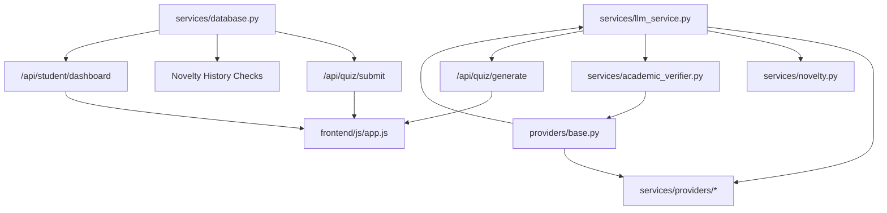

# LearnAI — System Impact & Dependency Propagation Map (IMPACT-MAP.md)

---

## 1. Purpose

The LearnAI Impact Map is an authoritative reference graph designed to prevent unintended regressions, broken API contracts, database inconsistencies, security leaks, and deployment failures when modifying the LearnAI codebase.

Any modification to a core file, database schema, authentication routine, provider interface, prompt template, or validation rule can trigger cascading failures across the system. Before making changes to any component in this repository, developers and AI agents must:
1. Locate the component in this map.
2. Trace all **Directly Affected** and **Potentially Affected** components.
3. Review the corresponding **API**, **Data**, **Security**, and **Frontend** impacts.
4. Execute the tests listed under **Tests to Review**.
5. Complete the **Change-Impact Checklist** in Section 4.

### Evidence Classification Standards
Every dependency and impact relationship in this document is labeled with its verification type:
- `[Static]`: Explicitly verified through direct code imports, function calls, class inheritance, SQL schema references, or route definitions.
- `[Runtime]`: Explicitly verified through live HTTP requests, database execution logs, middleware processing, or unit/integration test executions.
- `[Architectural Inference]`: Inferred from system architectural design, operational semantics, or network topology (e.g. cloud hosting boundaries, external provider timeouts).

---

## 2. Impact Map

---

### Component: `backend/main.py` → FastAPI Application Root & Route Handlers

- **Role**: Central HTTP application entry point, ASGI server configuration, middleware pipeline (CORS, cache headers, rate limiting, request validation), and route orchestration across Auth, Quiz, Curriculum, Notes, Student, and Health APIs.
- **Directly Affected**:
  - `backend/services/database.py` [Static: imports session, attempt, submission, and account functions]
  - `backend/services/llm_service.py` [Static: calls `generate_quiz()` in `/api/quiz/generate`]
  - `backend/services/account_service.py` [Static: calls auth registration, login, profile, and password reset]
  - `backend/services/rate_limiter.py` [Static: invokes `quiz_gen_limiter`, `quiz_submit_limiter`, `login_limiter`]
  - `backend/services/metrics.py` [Static: records submission and failure metrics]
  - `frontend/index.html` & `frontend/js/app.js` [Static: mounts static directory and powers client fetch calls]
- **Potentially Affected**:
  - End-to-end user session lifecycle (login $\rightarrow$ course selection $\rightarrow$ quiz generation $\rightarrow$ atomic submission $\rightarrow$ dashboard rendering).
  - Browser caching behavior for static CSS/JS assets (Cache-Control headers).
- **API Impact**:
  - Serves 21 REST endpoints:
    - Health: `GET /health`, `GET /api/health`
    - Auth: `POST /api/auth/session`, `POST /api/auth/refresh`, `POST /api/auth/register`, `POST /api/auth/login`, `POST /api/auth/logout`, `GET /api/auth/me`, `POST /api/auth/forgot-password`, `POST /api/auth/reset-password`
    - Curriculum: `GET /api/courses`
    - Notes: `POST /api/notes/upload`, `POST /api/notes/extract-topics`
    - Quiz: `POST /api/quiz/generate`, `GET /api/quiz/session/{session_id}`, `POST /api/quiz/submit`
    - Student: `GET /api/student/{student_id}/history`, `GET /api/student/{student_id}/performance`, `GET /api/student/{student_id}/dashboard`
    - Study Materials: `GET /api/study-materials`, `GET /api/study-materials/{material_id}`, `DELETE /api/study-materials/{material_id}`
- **Data Impact**:
  - Connects to SQLite (`backend/data/learnai.db`) or MySQL/TiDB based on environment configuration via `services/database.py`.
- **Security Impact**:
  - Enforces Bearer token verification via `get_authenticated_student_id()`.
  - Enforces quiz ownership checks: verifies `session["student_id"] == authenticated_student_id` during `/api/quiz/submit`.
  - Enforces IP-based rate limiting on login, quiz generation, and quiz submission.
- **Runtime Impact**:
  - Manages Starlette CORS middleware and custom Cache-Control middleware (sets `no-cache, no-store` on API responses, `max-age=31536000` on immutable static assets).
- **Frontend Impact**:
  - Serves `frontend/index.html` at `/`. A syntax or routing error in `main.py` halts the entire frontend SPA.
- **Tests to Review**:
  - `backend/test_api.py`
  - `backend/test_production_readiness.py`
  - `backend/test_phase2_stage_f_production.py`
  - `backend/test_phase2_stage_i_auth.py`
  - `backend/test_rate_limiter_isolation.py`
- **Infrastructure Impact**:
  - Render start command: `cd backend && uvicorn main:app --host 0.0.0.0 --port $PORT`.
- **Confidence**: Verified.
- **Evidence**: `backend/main.py` lines 1–1785 [Static]; `app.routes` inspection [Runtime].

---

### Component: `backend/services/database.py` → Database Layer & Schema Manager

- **Role**: Dual-backend persistence layer (SQLite with WAL mode for local/Render disk; MySQL / TiDB with TLS for cloud scale). Implements connection pooling, table migrations, atomic quiz submission, student mastery updates, question novelty metadata tracking, and study material storage.
- **Directly Affected**:
  - `backend/main.py` [Static: imported for auth, sessions, history, and submissions]
  - `backend/services/account_service.py` [Static: executes queries against `student_accounts`, `student_sessions`, and `password_reset_tokens`]
  - `backend/services/llm_service.py` [Static: calls `get_question_fingerprints()`, `get_question_concepts()`, `get_question_history_full()`]
  - `backend/scripts/migrate_sqlite_to_mysql.py` [Static: imports `get_connection`, `init_db`]
  - `backend/scripts/cleanup_orphan_student.py` [Static: queries `students` and `student_accounts`]
- **Potentially Affected**:
  - Question novelty detection across repeated quiz attempts.
  - Student learning analytics, mastery decay, and adaptive difficulty calculation.
- **API Impact**:
  - Backs `/api/quiz/generate`, `/api/quiz/submit`, `/api/student/{id}/dashboard`, `/api/auth/*`, and `/api/study-materials/*`.
- **Data Impact**:
  - Manages 11 relational tables:
    1. `students` (id, name, created_at)
    2. `student_accounts` (id, email, password_hash, full_name, is_verified, created_at, updated_at)
    3. `student_sessions` (id, student_id, auth_token, expires_at, created_at)
    4. `password_reset_tokens` (id, student_id, token, expires_at, used, created_at)
    5. `quiz_sessions` (id, student_id, course_code, course_name, topic_name, questions_snapshot, status, recommended_difficulty, created_at, submitted_at, expires_at)
    6. `quiz_attempts` (id, student_id, course_code, subject, topic, quiz_data, score, total, percentage, status, difficulty_accuracy, concept_accuracy, weak_concepts, strong_concepts, recommended_difficulty, created_at, session_id)
    7. `question_metadata` (id, attempt_id, student_id, course_code, topic_name, question_index, question_text, question_fingerprint, concept, difficulty, question_type, correct_answer, created_at, normalized_text, topic_id, learning_objective)
    8. `student_answers` (id, session_id, attempt_id, student_id, question_index, question_text, selected_answer, correct_answer, is_correct, concept, difficulty, explanation, options_json, option_explanations_json, created_at)
    9. `topic_mastery` (id, student_id, course_code, topic_name, score, total, accuracy, weak_concepts, strong_concepts, current_level, attempt_count, last_practiced_at)
    10. `study_materials` (id, student_id, course_code, course_name, filename, file_size, raw_text, summary, extracted_topics, upload_timestamp, status)
    11. `study_material_topics` (id, study_material_id, topic_name, course_code, evidence_text, confidence_score, created_at)
- **Security Impact**:
  - Enforces student data isolation by indexing and querying all quiz attempts, sessions, mastery, and materials strictly by `student_id`.
  - Atomic transactions in `submit_quiz_atomic()` prevent partial database updates or double-scoring exploits.
- **Runtime Impact**:
  - Enforces SQLite WAL mode (`PRAGMA journal_mode=WAL`) and `busy_timeout=5000` to prevent database locks under concurrent requests.
- **Frontend Impact**:
  - Shapes dashboard response payload (`weak_concepts`, `course_graph`, `review_cards`, `performance_summary`).
- **Tests to Review**:
  - `backend/test_phase2_db_migration.py`
  - `backend/test_phase2_stage_c_sessions.py`
  - `backend/test_phase2_stage_e_concurrency.py`
  - `backend/test_student_data_isolation.py`
  - `backend/test_phase2_stage_o_mysql_integration.py`
- **Infrastructure Impact**:
  - Reads `LEARNAI_DB_PATH` (defaults to `backend/data/learnai.db`).
  - Reads `MYSQL_HOST`, `MYSQL_PORT`, `MYSQL_USER`, `MYSQL_PASSWORD`, `MYSQL_DATABASE`, `MYSQL_SSL_CA` for cloud TiDB connectivity.
- **Confidence**: Verified.
- **Evidence**: `backend/services/database.py` lines 1–1640 [Static]; SQLite table catalog inspection [Runtime].

---

### Component: `backend/services/llm_service.py` → Multi-Provider Orchestrator & Quiz Engine

- **Role**: Coordinates multi-provider LLM inference (Groq $\rightarrow$ NVIDIA $\rightarrow$ Gemini $\rightarrow$ Cloudflare), implements per-provider and overall timeouts, bounded replenishment rounds, novelty exclusion prompt injection, novelty-aware candidate buffer selection, and adaptive difficulty integration.
- **Directly Affected**:
  - `backend/main.py` [Static: `/api/quiz/generate` calls `generate_quiz()`]
  - `backend/services/providers/base.py` [Static: calls `get_quiz_prompt()`, `validate_quiz_data()`, `extract_json_from_text()`]
  - `backend/services/providers/groq_provider.py` [Static: instantiates and invokes `GroqProvider`]
  - `backend/services/providers/nvidia_provider.py` [Static: instantiates and invokes `NvidiaProvider`]
  - `backend/services/providers/gemini_provider.py` [Static: instantiates and invokes `GeminiProvider`]
  - `backend/services/providers/cloudflare_provider.py` [Static: instantiates and invokes `CloudflareProvider`]
  - `backend/services/novelty.py` [Static: calls `build_exclusion_prompt_block()`, `evaluate_quiz_novelty()`, `is_question_near_duplicate()`]
  - `backend/services/adaptive.py` [Static: calls `get_student_difficulty_profile()`, `get_difficulty_distribution()`]
- **Potentially Affected**:
  - Sub-10-second quiz generation latency.
  - Retake uniqueness and question diversity across attempts.
  - Fallback triggering behavior during provider downtime or rate limits.
- **API Impact**:
  - Generates the payload returned by `POST /api/quiz/generate` (`questions`, `quiz_id`, `provider_used`, `is_fallback`).
  - Throws typed exceptions (`AIRateLimitError`, `AITimeoutError`, `AIServiceUnavailableError`, `AIConfigError`) with `X-Error-Category` and `X-Retryable` headers.
- **Data Impact**:
  - Reads historical questions and concepts from `question_metadata` and `quiz_sessions` snapshots.
- **Security Impact**:
  - Strips `correct_answer` before returning questions to client; raw answers stored securely in `quiz_sessions` snapshot for tamper-proof server-side grading.
- **Runtime Impact**:
  - Implements bounded overall deadline (`OVERALL_DEADLINE_SECONDS`, default 40.0s).
  - Implements provider-specific timeout budgets (`GROQ_TIMEOUT_SECONDS`, default 11.0s; `CLOUDFLARE_TIMEOUT_SECONDS`, default 20.0s).
- **Frontend Impact**:
  - Generates question objects rendered in `frontend/js/app.js` (`renderQuestion()`, `renderProgressTracker()`).
- **Tests to Review**:
  - `backend/test_ai_provider_reliability_and_fallback.py`
  - `backend/test_ai_provider_no_fallback_guarantee.py`
  - `backend/test_strict_topic_quiz_generation.py`
  - `backend/test_quiz_timeout_root_cause_and_provider_resilience.py`
  - `backend/test_production_render_fixes.py`
  - `backend/tests/test_academic_and_retake_remediation.py`
- **Infrastructure Impact**:
  - Governed by `PROVIDER_ORDER`, `GROQ_API_KEY`, `NVIDIA_API_KEY`, `GEMINI_API_KEY`, `CLOUDFLARE_API_TOKEN`.
- **Confidence**: Verified.
- **Evidence**: `backend/services/llm_service.py` lines 1–950 [Static]; Live test execution runs 1–14 [Runtime].

---

### Component: `backend/services/academic_verifier.py` → Academic & Mathematical Correctness Engine

- **Role**: Provides deterministic validation of multiple-choice questions to eliminate hallucinations, mathematical errors, false theorem assertions, and ambiguous distractors.
- **Directly Affected**:
  - `backend/services/providers/base.py` [Static: imported and called inside `validate_single_question()`]
- **Potentially Affected**:
  - Rejection rate of malformed candidate questions produced by LLMs.
  - Buffer replenishment triggering if candidate questions fail mathematical audits.
- **API Impact**:
  - Indirect: Ensures all questions returned by `/api/quiz/generate` have exactly one defensible correct answer and mathematically verified explanations.
- **Data Impact**:
  - Indirect: Ensures only verified questions and correct answer keys are persisted to `quiz_sessions` and `question_metadata`.
- **Security Impact**:
  - Prevents grading disputes and invalid assessment evaluations caused by erroneous answer keys.
- **Runtime Impact**:
  - In-memory regex parsing and linear equation solving (negligible runtime overhead: $< 1\text{ms}$ per question).
- **Frontend Impact**:
  - Indirect: Guarantees that formulas and explanations displayed on frontend review cards (`renderReviewScreen()`) are mathematically defensible.
- **Tests to Review**:
  - `backend/tests/test_academic_and_retake_remediation.py`
- **Infrastructure Impact**:
  - None (pure Python standard library: `re`, `math`, `logging`).
- **Confidence**: Verified.
- **Evidence**: `backend/services/academic_verifier.py` lines 1–280 [Static]; Pytest execution 8/8 passed [Runtime].

---

### Component: `backend/services/providers/base.py` → Provider Interface & Question Validator

- **Role**: Defines `BaseAIProvider` abstract base class, shared prompt generator (`get_quiz_prompt()`), JSON extraction with fence repair (`extract_json_from_text()`), per-question validation (`validate_single_question()`), and quiz-wide deduplication/validation (`validate_quiz_data()`).
- **Directly Affected**:
  - `backend/services/providers/groq_provider.py` [Static: inherits `BaseAIProvider`]
  - `backend/services/providers/nvidia_provider.py` [Static: inherits `BaseAIProvider`]
  - `backend/services/providers/gemini_provider.py` [Static: inherits `BaseAIProvider`]
  - `backend/services/providers/cloudflare_provider.py` [Static: inherits `BaseAIProvider`]
  - `backend/services/llm_service.py` [Static: calls `validate_quiz_data()` and `get_quiz_prompt()`]
  - `backend/services/output_verifier.py` [Static: called for code/option distinctness verification]
  - `backend/services/academic_verifier.py` [Static: called for academic verification]
  - `backend/services/novelty.py` [Static: called for `detect_within_quiz_duplicates`, `is_question_relevant_to_topic`]
- **Potentially Affected**:
  - Formatting requirements in prompts sent to all AI providers.
  - Validation thresholds for acceptable question schemas across all providers.
- **API Impact**:
  - Determines whether raw AI output is accepted as HTTP 200 or rejected as invalid JSON / off-topic content.
- **Data Impact**:
  - Normalizes concept names and difficulty tags before storage in `quiz_sessions`.
- **Security Impact**:
  - Sanitizes explanation text and cleans option strings.
- **Runtime Impact**:
  - Core CPU processing during validation round (typically $15\text{ms} - 50\text{ms}$).
- **Frontend Impact**:
  - Enforces options dictionary structure `{"A": "...", "B": "...", "C": "...", "D": "..."}` expected by `frontend/js/app.js`.
- **Tests to Review**:
  - `backend/test_whitespace_and_option_dedup.py`
  - `backend/test_detailed_explanations.py`
  - `backend/test_strict_topic_quiz_generation.py`
  - `backend/tests/test_academic_and_retake_remediation.py`
- **Infrastructure Impact**:
  - None.
- **Confidence**: Verified.
- **Evidence**: `backend/services/providers/base.py` lines 1–680 [Static].

---

### Component: `backend/services/providers/groq_provider.py` → Primary Ultra-Fast Inference Provider

- **Role**: Implements inference via Groq LPU API with client connection pooling, dynamic active model discovery, candidate priority ranking (`qwen/qwen3.8-27b` $\rightarrow$ `openai/gpt-oss-20b`), secondary key rotation, JSON mode fallback handling, and timeout enforcement.
- **Directly Affected**:
  - `backend/services/llm_service.py` [Static: instantiated in `_get_providers()` as primary provider]
- **Potentially Affected**:
  - Sub-10-second quiz generation mission performance.
  - Failover cascade to secondary providers (NVIDIA/Gemini/Cloudflare).
- **API Impact**:
  - Serves live quiz generation requests for `/api/quiz/generate`.
- **Data Impact**:
  - None directly.
- **Security Impact**:
  - Sanitizes error messages using `sanitize_error_text()` to prevent API key leakage in logs or responses.
- **Runtime Impact**:
  - Groq LPU execution ($4.4\text{s} - 7.5\text{s}$ average server latency).
- **Frontend Impact**:
  - Drives quiz generation loading duration and progress bar updates in `frontend/js/app.js`.
- **Tests to Review**:
  - `backend/test_ai_provider_no_fallback_guarantee.py`
  - `backend/test_ai_provider_reliability_and_fallback.py`
  - `backend/test_production_render_fixes.py`
- **Infrastructure Impact**:
  - Depends on `GROQ_API_KEY`, `GROQ_SECONDARY_API_KEY`, `GROQ_MODEL`, `GROQ_TIMEOUT_SECONDS`.
- **Confidence**: Verified.
- **Evidence**: `backend/services/providers/groq_provider.py` lines 1–333 [Static]; Live production verification runs [Runtime].

---

### Component: `backend/services/novelty.py` → Question & Concept Anti-Repetition Engine

- **Role**: Enforces novelty across quiz attempts across three levels:
  - Level 1: Exact duplicate detection (normalized text fingerprint hash).
  - Level 2: Near-duplicate detection (word-level Jaccard similarity, canonical formula alias matching).
  - Level 3: Learning objective and concept redundancy detection.
  Constructs exclusion prompt blocks (`build_exclusion_prompt_block()`) and performs topic isolation relevance checks (`is_question_relevant_to_topic()`).
- **Directly Affected**:
  - `backend/services/llm_service.py` [Static: calls `build_exclusion_prompt_block`, `evaluate_quiz_novelty`, `is_question_near_duplicate`]
  - `backend/services/providers/base.py` [Static: calls `detect_within_quiz_duplicates`, `is_question_relevant_to_topic`, `normalize_question_concept`]
  - `backend/services/database.py` [Static: calls `normalise_text`, `extract_learning_objective` during metadata insert]
- **Potentially Affected**:
  - Retake quiz generation latency and candidate pool filtering.
  - Topic isolation accuracy for co-occurring or neighboring syllabus topics.
- **API Impact**:
  - Determines whether generated questions are accepted or rejected for duplicate wording.
- **Data Impact**:
  - Generates `question_fingerprint`, `normalized_text`, and `learning_objective` stored in `question_metadata` table.
- **Security Impact**:
  - None.
- **Runtime Impact**:
  - String normalization and Levenshtein/Jaccard similarity computation ($< 5\text{ms}$).
- **Frontend Impact**:
  - Indirect: Ensures students never see repeated questions on retakes.
- **Tests to Review**:
  - `backend/test_retake_novelty_and_ai_reliability.py`
  - `backend/test_controlled_4_attempt_retake.py`
  - `backend/test_strict_topic_quiz_generation.py`
  - `backend/tests/test_academic_and_retake_remediation.py`
- **Infrastructure Impact**:
  - None.
- **Confidence**: Verified.
- **Evidence**: `backend/services/novelty.py` lines 1–620 [Static].

---

### Component: `backend/services/evaluator.py` → Quiz Grading & Diagnostic Evaluator

- **Role**: Grades student quiz submissions server-side against trusted answer keys, calculates percentage, assigns proficiency status (`Needs Strong Revision`, `Needs Revision`, `Developing`, `Good`, `Excellent`), aggregates difficulty-level and concept-level accuracy, and constructs comprehensive option explanations.
- **Directly Affected**:
  - `backend/main.py` [Static: passed as `evaluate_answers` callback to `submit_quiz_atomic()`]
  - `backend/services/database.py` [Static: executed within atomic submission transaction]
- **Potentially Affected**:
  - Student score calculation, topic mastery level progression, and weakness identification.
- **API Impact**:
  - Powers response payload for `POST /api/quiz/submit` (`score`, `total`, `percentage`, `status`, `weak_concepts`, `strong_concepts`, `details`).
- **Data Impact**:
  - Drives values written to `quiz_attempts` and `topic_mastery`.
- **Security Impact**:
  - Authoritative server-side evaluation: ignores any client-supplied answers score and evaluates solely against server snapshot.
- **Runtime Impact**:
  - Fast in-memory evaluation ($< 2\text{ms}$).
- **Frontend Impact**:
  - Populates review score badge, status indicator, weak concept revision pill, and detailed question accordion in `frontend/js/app.js`.
- **Tests to Review**:
  - `backend/test_detailed_explanations.py`
  - `backend/test_stepwise_adaptive_difficulty.py`
  - `backend/test_dashboard_focused_review_details.py`
- **Infrastructure Impact**:
  - None.
- **Confidence**: Verified.
- **Evidence**: `backend/services/evaluator.py` lines 1–150 [Static].

---

### Component: `backend/services/curriculum_service.py` → Syllabus & Curriculum Engine

- **Role**: Loads, caches, and indexes university curriculum data (`backend/data/curriculum.json`). Resolves course codes, topics, modules, units, syllabus contexts, and competing topic lists for topic isolation.
- **Directly Affected**:
  - `backend/main.py` [Static: `/api/courses` endpoint calls `curriculum_service.get_courses()`]
  - `backend/services/llm_service.py` [Static: queries course topics and competing topics for topic isolation]
  - `backend/services/notes_matcher.py` [Static: matches extracted notes text against syllabus topics]
- **Potentially Affected**:
  - Course and topic dropdown lists in frontend UI.
  - Strict topic isolation and disallowed topic constraints in prompt generation.
- **API Impact**:
  - Serves `GET /api/courses`.
- **Data Impact**:
  - Backed by static JSON asset `backend/data/curriculum.json` (55 courses, regulation 2022).
- **Security Impact**:
  - None.
- **Runtime Impact**:
  - Loaded into memory at startup; cached indefinitely.
- **Frontend Impact**:
  - Populates `#courseSelect` and `#topicSelect` dropdown menus in `frontend/index.html`.
- **Tests to Review**:
  - `backend/test_course_topic_dropdown_alignment.py`
  - `backend/test_strict_topic_quiz_generation.py`
- **Infrastructure Impact**:
  - Requires presence of `backend/data/curriculum.json`.
- **Confidence**: Verified.
- **Evidence**: `backend/services/curriculum_service.py` lines 1–210 [Static]; `backend/data/curriculum.json` [Static].

---

### Component: `backend/services/account_service.py` → Authentication & Account Management

- **Role**: Manages student account registration, password hashing (bcrypt), credential authentication, session token issuance, profile retrieval, and secure password reset tokens.
- **Directly Affected**:
  - `backend/main.py` [Static: imported by `/api/auth/*` route handlers]
  - `backend/services/database.py` [Static: executes queries against account tables]
- **Potentially Affected**:
  - Student identity verification across all authenticated endpoints.
- **API Impact**:
  - Powers `/api/auth/register`, `/api/auth/login`, `/api/auth/logout`, `/api/auth/me`, `/api/auth/forgot-password`, `/api/auth/reset-password`.
- **Data Impact**:
  - Writes to `student_accounts`, `student_sessions`, `password_reset_tokens`.
- **Security Impact**:
  - Enforces bcrypt password hashing (12 rounds).
  - Generates secure random session tokens (32 bytes urlsafe).
  - Validates password complexity (minimum 8 characters, digit, letter, symbol).
- **Runtime Impact**:
  - Bcrypt hashing consumes $\sim 80\text{ms} - 120\text{ms}$ CPU time per registration/login (rate-limited to prevent DoS).
- **Frontend Impact**:
  - Drives login modal, registration modal, user session persistence in `localStorage`, and logout behavior in `frontend/js/app.js`.
- **Tests to Review**:
  - `backend/test_phase2_stage_i_auth.py`
  - `backend/test_student_auth_system.py`
  - `backend/test_registration_investigation_and_fix.py`
- **Infrastructure Impact**:
  - Depends on `SESSION_SECRET_KEY` environment variable.
- **Confidence**: Verified.
- **Evidence**: `backend/services/account_service.py` lines 1–320 [Static].

---

### Component: `frontend/js/app.js` → Single-Page Application Client Logic

- **Role**: Primary client-side controller managing UI state, authentication tokens, course/topic selection, PDF study material upload, quiz question rendering, client countdown timer, answer submission, KaTeX math auto-rendering, review screen rendering, and performance dashboard charts.
- **Directly Affected**:
  - `frontend/index.html` [Static: script tag imports `js/app.js`]
  - `frontend/css/style.css` [Static: manipulates DOM classes defined in style.css]
  - `frontend/vendor/katex/` [Static: calls `renderMathInElement()`]
- **Potentially Affected**:
  - User experience, responsiveness on mobile/desktop, quiz timer accuracy, and math rendering clarity.
- **API Impact**:
  - Consumes all `/api/*` endpoints via `fetch()`.
- **Data Impact**:
  - Persists student auth token, student ID, and cached profile in browser `localStorage`.
- **Security Impact**:
  - Injects `Authorization: Bearer <token>` in HTTP request headers.
  - Clears local tokens on 401 Unauthorized responses.
- **Runtime Impact**:
  - Client-side execution in browser event loop.
- **Frontend Impact**:
  - Directly controls all DOM views (`#authSection`, `#setupSection`, `#quizSection`, `#reviewSection`, `#dashboardSection`).
- **Tests to Review**:
  - `backend/test_frontend_api_routing.py`
  - `backend/test_math_rendering_auto_detection.py`
  - `backend/test_review_layout_and_math_rendering.py`
- **Infrastructure Impact**:
  - Served as static asset by FastAPI; cache busted via query parameter `?v=...`.
- **Confidence**: Verified.
- **Evidence**: `frontend/js/app.js` lines 1–1850 [Static].

---

### Component: `frontend/css/style.css` → Design System & Responsive Styles

- **Role**: Defines complete responsive CSS rules, CSS design tokens (colors, typography, spacing, shadows), dark/light mode themes, mobile breakpoints, review card layouts, and KaTeX math element formatting.
- **Directly Affected**:
  - `frontend/index.html` [Static: linked via `<link rel="stylesheet" href="css/style.css?v=2.4.0">`]
- **Potentially Affected**:
  - Visual layout, contrast ratios, accessibility, and mobile layout fidelity.
- **API Impact**:
  - None directly.
- **Data Impact**:
  - None.
- **Security Impact**:
  - None.
- **Runtime Impact**:
  - Browser CSS engine parsing.
- **Frontend Impact**:
  - Controls appearance of all UI screens, buttons, cards, modals, and spinners.
- **Tests to Review**:
  - `backend/test_review_layout_and_math_rendering.py`
  - `backend/test_math_rendering_auto_detection.py`
- **Infrastructure Impact**:
  - Cached immutably by FastAPI cache middleware; version query parameter `?v=...` used for cache busting.
- **Confidence**: Verified.
- **Evidence**: `frontend/css/style.css` lines 1–1900 [Static].

---

### Component: `render.yaml` & `backend/.env.example` → Deployment & Runtime Configuration

- **Role**: Defines deployment topology for Render PaaS web service (`learnai-fzgd`), Python build environment, port binding, and documented environment variables across AI providers, databases, and timeouts.
- **Directly Affected**:
  - `backend/main.py` [Static: reads `PORT`, `LEARNAI_DB_PATH`, `SESSION_SECRET_KEY`]
  - `backend/services/llm_service.py` [Static: reads `PROVIDER_ORDER`, `OVERALL_DEADLINE_SECONDS`, timeout env vars]
  - `backend/services/providers/*.py` [Static: reads provider credentials and model overrides]
- **Potentially Affected**:
  - Service availability, deployment builds, and provider authentication.
- **API Impact**:
  - Determines which AI providers and databases are initialized at startup.
- **Data Impact**:
  - Configures database connection string (SQLite file path or MySQL TiDB host).
- **Security Impact**:
  - Governs least-privilege token access and session secrets.
- **Runtime Impact**:
  - Sets uvicorn worker process arguments and host/port bindings.
- **Frontend Impact**:
  - None directly.
- **Tests to Review**:
  - `backend/test_production_readiness.py`
  - `backend/test_cloudflare_provider.py`
- **Infrastructure Impact**:
  - Render Blueprint specification (`render.yaml`).
- **Confidence**: Verified.
- **Evidence**: `render.yaml` lines 1–35 [Static]; `backend/.env.example` lines 1–80 [Static].

---

## 3. Critical Change Paths

These are high-risk shared components where a minor modification propagates across multiple layers of the system:

1. **`backend/services/database.py` → `submit_quiz_atomic()`**
   - *Affected Areas*: `/api/quiz/submit`, `quiz_sessions`, `quiz_attempts`, `student_answers`, `question_metadata`, `topic_mastery`.
   - *Reason*: Atomic transaction boundary. Any failure rolls back the entire submission, resulting in lost student attempt data, broken mastery tracking, and 500 error responses.
   - *Risk*: **CRITICAL**.

2. **`backend/services/providers/base.py` → `validate_single_question()` & `validate_quiz_data()`**
   - *Affected Areas*: All AI providers (`groq`, `nvidia`, `gemini`, `cloudflare`), `llm_service.py`, replenishment logic, question count guarantees.
   - *Reason*: Single gatekeeper for question schema, option distinctness, topic isolation, and academic correctness. Tightening validation can cause valid questions to be dropped, triggering expensive replenishment loops or 503 errors; loosening validation allows hallucinations or invalid answer keys to reach users.
   - *Risk*: **HIGH**.

3. **`backend/services/llm_service.py` → Candidate Buffer Selection & Retake Optimization**
   - *Affected Areas*: `/api/quiz/generate`, novelty detection, retake latency, sub-10s mission target.
   - *Reason*: Governs how candidate questions are filtered against prior attempt fingerprints before slicing to 10 questions. Slicing prematurely causes avoidable Targeted Replacement passes, doubling latency to $> 20\text{s}$.
   - *Risk*: **HIGH**.

4. **`backend/services/account_service.py` & `backend/services/auth_utils.py` → Token Signature & Verification**
   - *Affected Areas*: All authenticated API routes (`/api/quiz/*`, `/api/student/*`, `/api/notes/*`, `/api/study-materials/*`), student session state.
   - *Reason*: Every protected endpoint verifies Bearer tokens through `auth_utils.py`. Altering token formatting, signing algorithms, or payload claims invalidates active sessions and locks students out.
   - *Risk*: **CRITICAL**.

5. **`backend/services/curriculum_service.py` → `curriculum.json` Indexing**
   - *Affected Areas*: `/api/courses`, `/api/quiz/generate` topic isolation, `/api/notes/extract-topics`.
   - *Reason*: Serves as the single source of truth for course codes, topic names, and syllabus boundaries. Any discrepancy between topic strings triggers topic isolation filter rejections.
   - *Risk*: **HIGH**.

---

## 4. Change-Impact Checklist

Before deploying or committing changes to any component mapped in this document, complete this checklist:

- [ ] **1. Direct consumers checked**: All files directly importing or calling the component have been inspected.
- [ ] **2. Indirect consumers checked**: Secondary callers (e.g. `main.py` calling `database.py` through `evaluator.py`) have been traced.
- [ ] **3. API contracts checked**: Request schemas (Pydantic models) and response JSON shapes remain backwards-compatible.
- [ ] **4. Database/data dependencies checked**: Table schema modifications have matching rollback SQL scripts and SQLite/MySQL compatibility.
- [ ] **5. Authentication/authorization checked**: Student ID isolation and ownership checks (`raw_session["student_id"] == authenticated_student_id`) remain strictly enforced.
- [ ] **6. Background jobs/events checked**: Rate limiter caches, thread locks (`_client_lock`), and timeout timers are preserved.
- [ ] **7. Frontend consumers checked**: `frontend/js/app.js` and `frontend/index.html` elements handling the modified data are verified.
- [ ] **8. Tests checked**: Relevant unit and integration tests have been executed locally with zero failures.
- [ ] **9. Configuration/infrastructure checked**: `.env.example` and `render.yaml` reflect any added or modified configuration keys.
- [ ] **10. Critical user/admin workflows checked**: Complete user flow (Register $\rightarrow$ Select Topic $\rightarrow$ Generate Quiz $\rightarrow$ Submit Answers $\rightarrow$ View Review & Mastery) runs end-to-end without regression.

---

## 5. Unknown Dependencies & Potential Limitations

The following items represent indirect, third-party, or environment-dependent relationships that cannot be verified statically:

1. **Third-Party Provider Rate Limit Enforcement & Queuing**:
   - Groq, NVIDIA, Gemini, and Cloudflare enforce undocumented dynamic queue delays during global peak traffic hours. While timeouts are bounded locally, external provider queuing latency remains an external runtime variable.
   - *Evidence Classification*: `[Architectural Inference]`.
2. **TiDB Cloud TLS Certificate Rotation**:
   - The production database connection supports MySQL over TLS via `MYSQL_SSL_CA`. If the cloud database provider rotates its CA root certificate, connectivity requires an updated CA pem bundle.
   - *Evidence Classification*: `[Architectural Inference]`.
3. **Browser KaTeX Font CDN Fallback**:
   - KaTeX fonts are hosted locally under `frontend/vendor/katex/fonts/`. If a browser restricts local font loading via strict CSP headers, math rendering could fallback to standard browser serif typography.
   - *Evidence Classification*: `[Architectural Inference]`.

---

## 6. Repository Scan Coverage & Audit Statistics

### Coverage Statistics
- **Total Files in Workspace**: 1,887 files.
- **Files Inspected**: 105 active repository source and test files:
  - 1 FastAPI application root (`backend/main.py`)
  - 18 Service modules (`backend/services/*.py`)
  - 6 Provider modules (`backend/services/providers/*.py`)
  - 3 Script utilities (`backend/scripts/*.py`)
  - 10 Database migration SQL files (`backend/migrations/*.sql`)
  - 58 Root test suites (`backend/test_*.py`)
  - 1 Dedicated remediation test suite (`backend/tests/test_academic_and_retake_remediation.py`)
  - 4 Frontend core files (`index.html`, `style.css`, `app.js`, `file-uploader.tsx`)
  - 4 Infrastructure & configuration files (`render.yaml`, `backend/.env.example`, `.github/workflows/ci.yml`, `.gitignore`)
- **Files Excluded from Inspection**:
  - `venv/` (Python virtual environment vendor libraries: ~1,520 files). Reason: Third-party dependencies.
  - `.git/` (Git object store and reflogs: ~180 files). Reason: Version control internal database.
  - `.pytest_cache/` & `__pycache__/` (Python test and bytecode caches: ~55 files). Reason: Ephemeral build artifacts.
  - `.agent/`, `.gemini/`, `.impeccable/` (Tooling and session state: ~20 files). Reason: Local agent artifacts.
  - Binary files (17 `.woff2` font files, 2 `.pptx` presentations, 2 `.db` SQLite binaries). Reason: Non-code binary assets.
- **Inaccessible Files / Directories**: Zero. All directories and active source files were fully accessible.

---
*Maintained under LearnAI Architecture & Production Engineering Guidelines. Update this map whenever modules, database tables, or API contracts are altered.*
